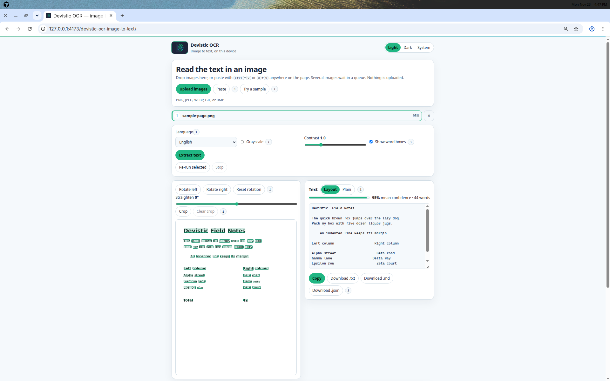
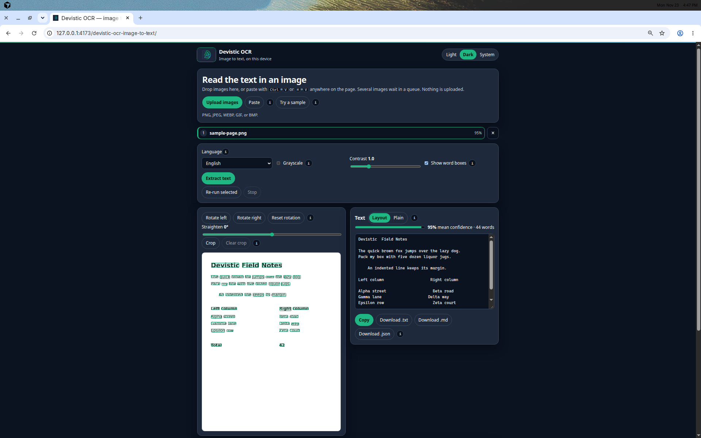

# Devistic OCR

Free image-to-text that runs entirely in your browser. Line breaks, indents, and columns stay close to the page. There is no account, no API key, and no upload.

**Live:** https://devistic-asim.github.io/devistic-ocr-image-to-text/





## Features

- Add images by upload, drag-and-drop, or paste (`Ctrl`+`V` / `⌘`+`V` anywhere, or the Paste button)
- Queue several images and run them on one reused Tesseract worker
- English by default, plus Urdu, Arabic, Hindi, and other common Tesseract languages, downloaded the first time you pick them and cached in IndexedDB
- Progress while the engine and language data load, then while the page is read
- **Layout** text that keeps line breaks, paragraph gaps, indentation, and column spacing, or **Plain** text that reflows paragraphs
- Optional grayscale, contrast, rotate, straighten, and crop before recognition
- Mean confidence, a count of weak words, and clickable word boxes colored by confidence
- Copy, or download `.txt`, `.md`, and `.json` (JSON includes each word’s box and confidence)
- History stored in this browser, with import and export as JSON (and a plain-text export of every result)
- Light, dark, and system themes, saved on this device

## How to use

1. Drop, upload, or paste an image. PNG, JPEG, WEBP, GIF, and BMP work best. Or choose **Try a sample**.
2. Pick the language. English is the default. The first time you choose another language, its traineddata file downloads and is cached in this browser.
3. If the photo is sideways, faint, or has a large margin, rotate it, raise the contrast, or crop it. Then choose **Extract text**.
4. Use **Layout** when the arrangement matters (columns, indents, line breaks). Use **Plain** when you want paragraphs you can edit.
5. Copy the text, or download it. Results are kept under **On this device** until you remove them or clear local data.

Low-confidence words (under 70%) are the ones most worth a second look. Click a box on the image to copy that word.

## How layout preservation works

Tesseract’s plain string throws away geometry. Devistic OCR asks the worker for `blocks` as well as `text`. Each block contains paragraphs, lines, and words, and every word has a bounding box and a confidence score.

**Layout mode** (`src/lib/layout.ts`) rebuilds a monospace page from those boxes:

1. Estimate a character width from the median of `(word width / character count)`, and a line height from the line boxes.
2. Lines whose vertical centers are within about half a line-height share a row. A left column and a right column therefore stay on one line, with spaces between them.
3. Place each word at `column = round((word.left − leftMargin) / characterWidth)`. The cursor then advances by the word’s painted width, so a larger heading does not open a fake gap before the next word. A normal inter-word gap stays a single space. A wide gap stays a run of spaces, which is what holds columns and tables.
4. A vertical gap taller than the line itself becomes a blank line. Smaller gaps stay single line breaks, so wrapped lines are not turned into empty paragraphs. Leading spaces keep an indent.
5. Right-to-left words are wrapped in Unicode isolates (`U+2066` … `U+2069`) so the bidi algorithm does not pull spatially placed words back together.

**Plain mode** ignores the grid. It reads full-width regions first, then the left column top to bottom, then the right column. Inside a paragraph, lines that share a wide vertical gutter are split the same way: the left side is joined into a paragraph, then the right side. Other lines are joined with spaces. A hyphen at the end of a line is glued to the next line when that line starts with a letter.

Page segmentation is Tesseract’s automatic mode (`PSM 3`), with `preserve_interword_spaces` on. The layout you see is computed from the boxes after recognition, not from Tesseract’s plain string.

## Tech stack

- Vite, React, and TypeScript
- [Tesseract.js](https://github.com/naptha/tesseract.js) 6 in a web worker (`tesseract.js-core` WASM). Language data comes from the jsDelivr copy of tessdata the library uses by default, then sits in IndexedDB under the `devistic-ocr/` prefix
- No backend, no analytics, no tracker
- Vitest for the layout, export, storage, and contrast logic. GitHub Actions runs lint, tests, and the production build

## Run locally

```bash
npm install
npm test
npm run dev
```

The dev server uses the same base path as GitHub Pages, so open the URL it prints under `/devistic-ocr-image-to-text/`.

```bash
npm run build
npm run preview
```

`npm run build` also copies `index.html` to `404.html` so GitHub Pages can serve the app on a direct refresh.

## Privacy

We don't use cookies for tracking and we don't collect or store your data on any server. Everything stays in your browser on this device.

Images and recognized text are kept in `localStorage` on this origin (history is capped, and only a small thumbnail is stored). Theme and settings use the same storage. The OCR engine and language files are fetched from a public CDN the first time they are needed. The image is not part of that request. **Clear my local data** removes this app’s `localStorage` keys and its IndexedDB language cache. It does not delete other sites’ data on a shared GitHub Pages origin.

## GitHub Pages

Pushes to `main` run `.github/workflows/deploy.yml`, which builds with base `/devistic-ocr-image-to-text/` and deploys with `actions/configure-pages`, `actions/upload-pages-artifact@v3`, and `actions/deploy-pages@v4`.

The repository owner needs **Settings → Pages → Build and deployment → Source** set to **GitHub Actions** before the first deploy can succeed.

## Contributing

See [CONTRIBUTING.md](CONTRIBUTING.md) and the [code of conduct](CODE_OF_CONDUCT.md).

## License

[MIT](LICENSE) © devistic-asim

## Contact

[github.com/devistic-asim](https://github.com/devistic-asim) · [Star or contribute](https://github.com/devistic-asim/devistic-ocr-image-to-text)
